# Arquitetura do Sentinel Audit Tool

Mapa de todos os módulos, pacotes e classes, do desenho macro (quem fala com quem) ao micro (o que cada classe faz).
Os diagramas são Mermaid e aparecem desenhados no GitHub e no VS Code.

> **Escopo.** "Todos os projetos" aqui são os módulos do repositório `sentinel`: `audit-api` (backend), `audit-cli`, `audit-dashboard` (frontend), `audit-rules` (regras e configuração das ferramentas), `deploy` (Docker/Helm) e a automação (`.github`, `scripts`). O app `frequency` é outro repositório e não está neste documento.
> **Origem.** Escrito a partir do código da `main` (119 classes Java em `audit-api`, 4 em `audit-cli`, 33 arquivos TypeScript/TSX em `audit-dashboard/src`). Nomes de classe foram conferidos contra o código. Onde uma descrição vem só do comentário da classe e não da leitura do corpo, o texto diz "segundo o comentário".

## Sumário
1. [Desenho macro](#1-desenho-macro)
2. [Features e onde vivem](#2-features-e-onde-vivem)
3. [Backend `audit-api`](#3-backend-audit-api) (micro: fluxo, camadas, analisadores, pacotes, score, ciclo de vida, dados)
4. [CLI `audit-cli`](#4-cli-audit-cli)
5. [Frontend `audit-dashboard`](#5-frontend-audit-dashboard)
6. [Regras e ferramentas `audit-rules`](#6-regras-e-ferramentas-audit-rules)
7. [Implantação e segurança](#7-implantação-e-segurança)
8. [Automação: CI, release e agentes](#8-automação-ci-release-e-agentes)
9. [Terceiros](#9-terceiros)
10. [Limites deste documento](#10-limites-deste-documento)

---

## 1. Desenho macro

### 1.1 Contexto: quem usa e com quem o Sentinel conversa

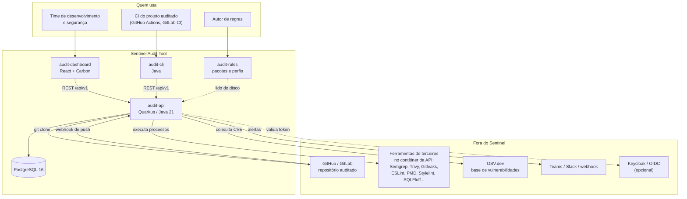

### 1.2 Contêineres e implantação

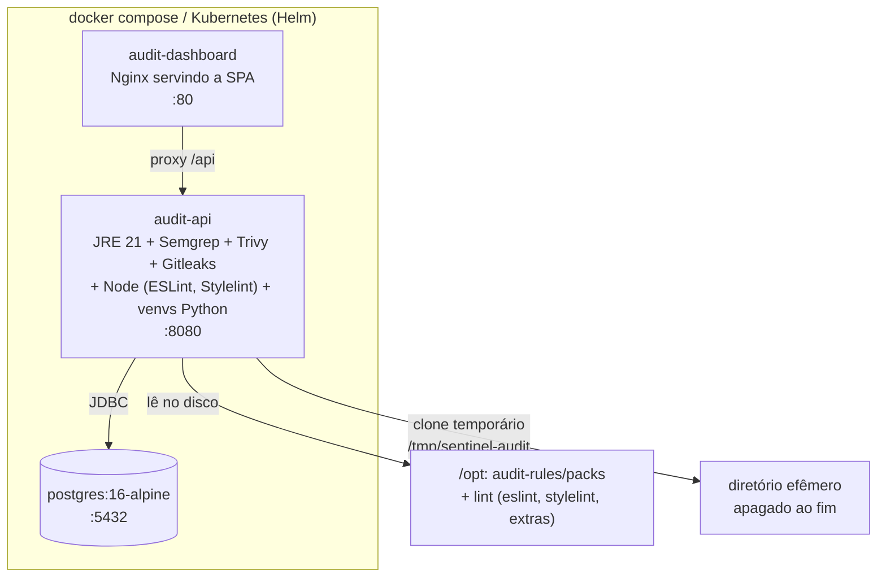

### 1.3 O caminho de uma auditoria (visão de pássaro)

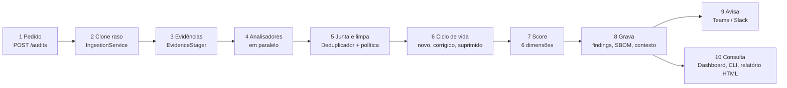

---

## 2. Features e onde vivem

| Feature | Backend (`audit-api`) | Outros módulos |
|---|---|---|
| Cadastrar sistemas e disparar auditorias | `SystemResource`, `AuditResource`, `AuditRequestService`, `AuditOrchestrationService` | Dashboard: `OverviewPage`; CLI: `AuditCli` |
| Auditoria automática por agenda | `AuditScheduler` (a cada 5 min) | Dashboard: `ScheduleForm` |
| Auditoria por webhook de push | `WebhookResource`, `WebhookService` | GitHub / GitLab |
| Análise de segurança e qualidade | `SemgrepAnalyzer`, `PmdAnalyzer`, `EslintAnalyzer`, `CleanCodeAnalyzer` | `audit-rules/packs`, `audit-rules/lint` |
| Dependências vulneráveis (SCA) e SBOM | `OWASPDependencyAnalyzer`, `OsvClient`, `TrivyAnalyzer`, `SbomWriter` | OSV.dev, Trivy |
| Segredos (arquivos e histórico) | `GitleaksAnalyzer`, `SecretsAnalyzer`, `HistorySecretsAnalyzer` | Gitleaks |
| Arquitetura em camadas e componentes | `ArchitectureAnalyzer`, `ArchitecturePolicyAnalyzer` | `architecture.yml` do pacote |
| Evidências do banco e da execução | `EvidenceAnalyzer`, `EvidenceStager` | pasta `evidencias/<sistema>/` |
| Qualquer ferramenta que fale SARIF | `SarifAnalyzer`, `ToolSpec` | `audit-rules/packs/market-tools/tools` |
| Pacotes e perfis de regras | pacote `pack` (`PackLoader`, `PackRegistry`, `PackIntegrity`...) | `audit-rules/packs`, ferramenta `sentinel-pack` |
| Score de risco (6 dimensões) | `ScoringService`, `SourceSizer` | Dashboard: `ScoreGauge` |
| Novo × corrigido × suprimido, tendência | `FindingLifecycleService`, `Fingerprints`, `FindingResource` | Dashboard: `DiffSummary`, `TrendChart`, `SuppressModal` |
| Auditoria completa (áreas, dívida, plano) | pacote `insights` | Dashboard: `InsightsPanel` |
| Relatório HTML | `ReportService` | Dashboard: `ReportsPage` |
| Orientação de correção por regra | `RemediationCatalog`, `RemediationDto` | `remediation/` de cada pacote; `RemediationBlock` |
| Qualidade das regras (falso positivo) | `RuleQualityService`, `RuleResource` | Dashboard: `RankingPage` |
| Laboratório de regras | `RulePlaygroundService` | `PackLoader` |
| Auditoria de PR (só o que mudou) | `ChangedFiles` | `AuditCli` (`--fail-on-new`) |
| Portão de qualidade em CI | endpoints de `AuditResource` | `AuditCli`, `SarifWriter`, `JUnitWriter`, `MarkdownWriter` |
| Notificações | `NotificationService` | Teams, Slack, webhook |
| Autenticação | `ApiKeyFilter`; OIDC opcional (`-Poidc`) | Keycloak |
| Evolução automática do próprio Sentinel | — | `.github/workflows`, `.github/agente`, `scripts`, `docs/evolucao` |

---

## 3. Backend `audit-api`

Pacote raiz: `com.sentinel.audit`. Quarkus 3.15, Java 21, Hibernate/Panache, PostgreSQL, CDI (`@ApplicationScoped`), REST (JAX-RS).

### 3.1 Camadas (desenho micro)

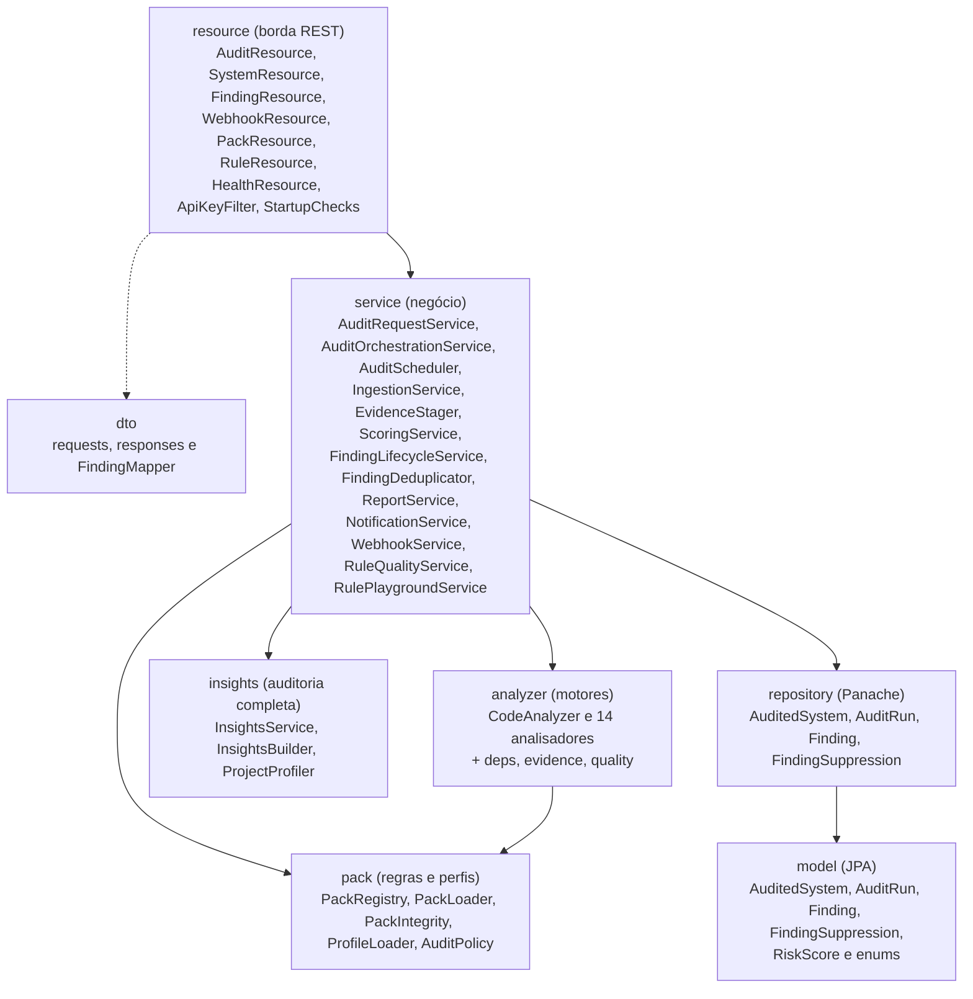

Regra de leitura: a seta vai de quem chama para quem é chamado. `resource` nunca fala com `analyzer` diretamente; só `AuditOrchestrationService` orquestra os analisadores.

### 3.2 Fluxo de uma auditoria (sequência)

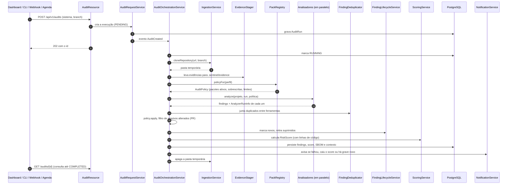

Pontos do código que valem saber (do comentário de `AuditOrchestrationService`): nenhuma entidade JPA é usada fora de transação; a execução espera o registro da auditoria ficar visível no banco; falha de um analisador não derruba a auditoria (vira `FALHOU` em `AnalyzerRunInfo`); campos de texto são truncados ao tamanho das colunas; só rodam analisadores que suportam a stack do sistema.

**Andamento e cancelamento.** `AuditProgressTracker` guarda a etapa, os analisadores e os eventos das auditorias em execução: a réplica que executa mantém o estado em memória e o espelha na tabela `audit_progress` (`ProgressStore`, uma gravação por mudança e um batimento a cada 15 s); as demais réplicas leem o espelho, então a tela mostra o andamento qualquer que seja a réplica que atende. Cancelar (`POST /audits/{id}/cancel`) muda o status para `CANCELLED` no banco na hora; a réplica que executa percebe o status (consulta no máximo 1×/s) e a orquestração para na próxima verificação (entre as etapas e a cada 0,5 s enquanto espera os analisadores), descarta o que foi analisado e limpa o clone. Auditorias órfãs (a réplica caiu) são detectadas por falta de batimento por 90 s e marcadas `FAILED` por `AuditScheduler.recoverInterruptedRuns()`, no start e a cada 5 min. O agendamento automático continua assumindo uma única instância (`SCHEDULER_ENABLED=false` nas demais). O espelho é auxiliar: se o banco falhar, a auditoria segue só com a memória.

### 3.3 Pacote `resource` (borda REST)

| Classe | O que faz | Rotas |
|---|---|---|
| `SystemResource` | Cadastro, edição e consulta de sistemas, verificação do repositório, agenda, perfil, tendência, supressões | `/api/v1/systems`, `/check-repo`, `/{id}`, `/{id}/audits`, `/{id}/trend`, `/{id}/suppressions`, `/{id}/schedule`, `/{id}/profile` |
| `AuditResource` | Cria, lista e cancela auditorias; entrega resultado com andamento, achados, diferença, plano de correção, relatórios (técnico, executivo, comparativo, CSV), SBOM e visão completa | `/api/v1/audits`, `/{id}`, `/{id}/cancel`, `/{id}/fix-plan`, `/{id}/findings`, `/{id}/findings.csv`, `/{id}/diff`, `/{id}/report`, `/{id}/sbom`, `/{id}/insights` |
| `FindingResource` | Suprime um achado com justificativa; lista os achados de todos os sistemas | `POST /api/v1/findings/{id}/suppress`, `GET /api/v1/findings` |
| `WebhookResource` | Recebe push do GitHub e do GitLab | `/api/v1/webhooks/github`, `/gitlab` |
| `PackResource` | Lista pacotes e perfis; recarrega do disco | `/api/v1/packs`, `/reload` |
| `RuleResource` | Qualidade das regras e laboratório | `/api/v1/rules/quality`, `/playground` |
| `HealthResource` | Verificação de saúde | `/api/v1/health` |
| `ApiKeyFilter` | Exige a chave `X-API-Key` quando `API_KEY` está definida | filtro global |
| `StartupChecks` | Avisa na partida sobre configuração insegura ou destrutiva | — |

### 3.4 Pacote `service` (negócio)

| Classe | O que faz |
|---|---|
| `AuditOrchestrationService` | Maestro: clona, roda analisadores em paralelo, deduplica, aplica política, calcula score, grava e notifica |
| `AuditRequestService` | Cria a execução (`PENDING`) e dispara o evento `AuditCreated` |
| `AuditCreated` | Evento CDI "auditoria criada" |
| `AuditScheduler` | A cada 5 minutos dispara auditorias agendadas e recupera as que ficaram `RUNNING` por causa de um reinício |
| `IngestionService` | Clona o repositório (raso, com token e lista de hosts permitidos) e apaga a pasta ao fim |
| `ChangedFiles` | Lista arquivos alterados contra um branch base (auditoria de PR) |
| `EvidenceStager` | Copia as evidências do sistema para `.sentinel/evidence/` dentro do clone |
| `FindingDeduplicator` | Junta o mesmo problema vindo de ferramentas diferentes (fica o do Semgrep, com a maior severidade) |
| `Fingerprints` | Identidade estável de um achado entre auditorias |
| `FindingLifecycleService` | Marca o que é novo, aplica supressões, compara com a auditoria anterior (novo × corrigido) e calcula a tendência de score |
| `ScoringService` | Score por dimensão e geral |
| `SourceSizer` | Conta linhas de código (base do score por densidade) |
| `RemediationCatalog` | Devolve a orientação de correção pelo id da regra (vale a chave mais específica) |
| `ReportService` | Relatório HTML |
| `NotificationService` | Avisos para Teams, Slack ou webhook genérico |
| `WebhookService` | Valida a autenticidade, acha o sistema pelo repositório e dispara se o push é na branch configurada |
| `RuleQualityService` | Mede quais regras viram falso positivo com frequência |
| `RulePlaygroundService` | Valida e executa uma regra Semgrep sobre um trecho de código |

### 3.5 Pacote `analyzer` (motores de análise)

Contrato: `CodeAnalyzer` (`getName`, `supports(stack)`, `isAvailable()`, `analyze(...)`, `replaces()`). `replaces()` faz um analisador desligar outro que cobre o mesmo (com o Gitleaks no PATH, os analisadores internos de segredos não rodam). Cada execução devolve um `AnalyzerResult`.

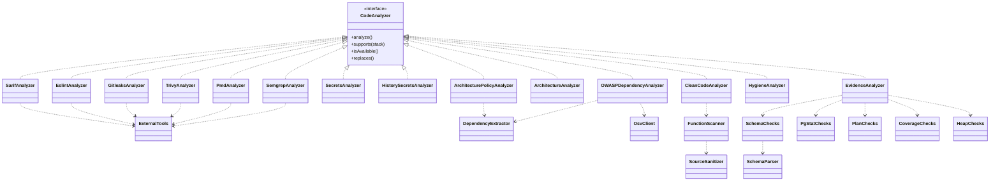

| Classe | O que analisa |
|---|---|
| `SemgrepAnalyzer` | Roda o Semgrep com as regras dos pacotes ativos (segurança, qualidade, Spring, persistência, IaC, front); ignora bibliotecas embutidas (`node_modules`, `vendor`, `*.min.js`...) |
| `PmdAnalyzer` | Lint de Java com PMD (boas práticas, propensão a erro, design) |
| `EslintAnalyzer` | Lint de TypeScript/JavaScript com ESLint; só liga as regras do Angular se o projeto depende de `@angular/*` |
| `SarifAnalyzer` | Importa o SARIF 2.1.0 de qualquer ferramenta declarada em `tools/*.yml` dos pacotes (Stylelint, SQLFluff, Hadolint, Checkov, Spectral, Squawk, Checkstyle, jscpd, Dependency-Cruiser, njsscan, kube-linter, kube-score) |
| `TrivyAnalyzer` | Vulnerabilidades em dependências e más configurações de IaC/Dockerfile/Kubernetes |
| `GitleaksAnalyzer` | Segredos em arquivos atuais e no histórico do Git |
| `SecretsAnalyzer` | Segredos no código (fallback interno quando não há Gitleaks) |
| `HistorySecretsAnalyzer` | Segredos que existiram em commits antigos (fallback interno) |
| `OWASPDependencyAnalyzer` | SCA: lê manifestos, consulta o OSV.dev e classifica pela nota CVSS |
| `ArchitectureAnalyzer` | Violações arquiteturais e de observabilidade em Java (camadas, entidade exposta em controller...) |
| `ArchitecturePolicyAnalyzer` | Aplica o `architecture.yml` do pacote: dependências proibidas entre camadas, convenções por arquivo, arquivos obrigatórios, política de versões de componentes |
| `CleanCodeAnalyzer` | Função longa, parâmetros demais, complexidade ciclomática, aninhamento (Java e TS/JS) |
| `HygieneAnalyzer` | README, testes, CI, lockfile, segredos versionados, artefatos de build commitados, `.dockerignore` |
| `EvidenceAnalyzer` | Lê evidências geradas fora: dump do esquema, estatísticas e planos do Postgres, cobertura, histograma de memória |
| `ExternalTools` | Utilidades de execução de processos externos e de detecção de ferramenta no PATH |
| `AnalyzerResult` | Resultado imutável de um analisador (achados, nome, duração) |

Subpacotes:

| Subpacote | Classes |
|---|---|
| `analyzer.deps` | `DependencyExtractor` (lê `pom.xml`, `package.json`, lockfiles...), `Dependency`, `OsvClient` (API do OSV.dev), `OsvVulnerability`, `Cvss` (nota base v3.x), `SbomWriter` (CycloneDX 1.5) |
| `analyzer.evidence` | `SchemaParser` (DDL → tabelas, chaves, índices), `SchemaChecks`, `PgStatChecks` (CSV de `pg_stat_*`), `PlanChecks` (EXPLAIN JSON), `CoverageChecks` (JaCoCo, lcov), `HeapChecks`, `Csv`, `Ev` (monta os achados) |
| `analyzer.quality` | `FunctionScanner` (acha funções e mede), `SourceSanitizer` (apaga comentários e strings antes de medir) |

### 3.6 Pacote `pack` (pacotes de regras e perfis)

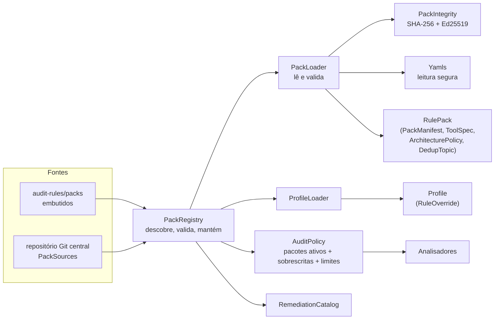

| Classe | O que faz |
|---|---|
| `PackRegistry` | Descobre, valida e mantém pacotes e perfis; entrega a `AuditPolicy` de cada sistema; recarrega do disco |
| `PackLoader` | Lê e valida um pacote; a mensagem de erro lista todos os problemas, não só o primeiro |
| `PackIntegrity` | `pack.lock` (SHA-256 de cada arquivo) e `pack.sig` (assinatura Ed25519 do lock) |
| `PackSources` | Obtém pacotes de um repositório Git central |
| `PackTool` | Linha de comando `sentinel-pack` para autores (criar, validar, testar) |
| `ProfileLoader` / `Profile` | Perfis (`profiles/*.yml`): pacotes ativos, sobrescritas e limites de clean code por grupo de sistemas |
| `AuditPolicy` | O que vale numa auditoria; aplica sobrescritas (desligar, mudar severidade, modo sombra) aos achados |
| `RulePack` / `PackManifest` | Pacote carregado e sua identidade (`pack.yml`) |
| `RuleOverride` | Ajuste de uma regra feito por um perfil |
| `ToolSpec` | Fonte SARIF declarada por um pacote, sem código Java |
| `ArchitecturePolicy` | Camadas e componentes declarados em YAML |
| `DedupTopic` | Grupo de regras de ferramentas diferentes que apontam o mesmo problema |
| `RemediationEntry` | Orientação de correção por regra |
| `Versions` | Comparação de versões para a política de componentes |
| `Yamls` | Leitura de YAML sem instanciar classes (evita o risco clássico do SnakeYAML) |
| `PackException` | Pacote inválido |

### 3.7 Score de risco

`ScoringService` calcula cada dimensão e o geral.

| Dimensão | Peso no geral |
|---|---:|
| Segurança (`SECURITY`) | 30% |
| Qualidade (`QUALITY`) | 20% |
| Arquitetura (`ARCHITECTURE`) | 20% |
| Dependências (`DEPENDENCY`) | 10% |
| Observabilidade (`OBSERVABILITY`) | 10% |
| Desempenho (`PERFORMANCE`) | 10% |

A penalidade de severidades baixas repetidas da mesma regra tem teto de 20 pontos, e projetos grandes recebem um fator de densidade (a raiz de referência/linhas) sobre as penalidades, exceto as críticas. Por isso muitos achados de estilo quase não mexem na nota.

### 3.8 Ciclo de vida do achado

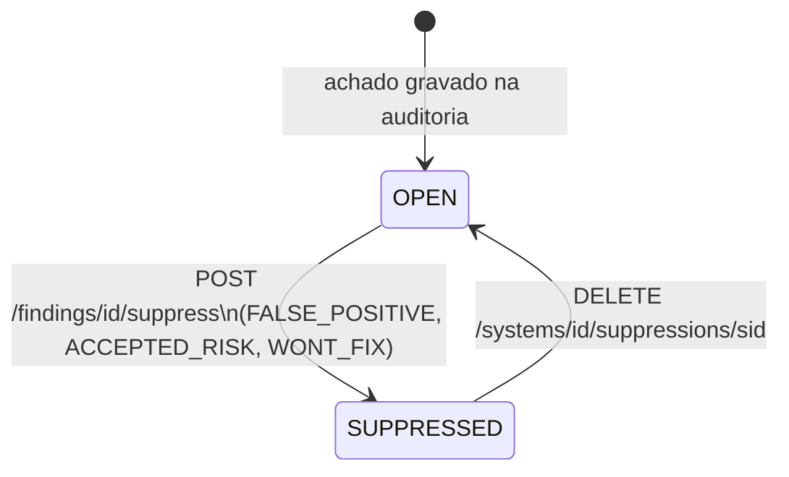

- O código só grava dois estados: `OPEN` e `SUPPRESSED` (`FindingLifecycleService`). Os valores `ACKNOWLEDGED` e `FIXED` existem no enum `FindingStatus`, mas nenhum serviço os atribui hoje.
- "Novo" e "corrigido" não são estados gravados: saem da **comparação com a auditoria anterior** pela identidade estável (`Fingerprints`). Achado que está na atual e não estava é novo; achado que estava e sumiu é corrigido. O resultado é o `AuditDiffResponse` (`GET /audits/{id}/diff`).
- Suprimir ou reabrir recalcula o score da auditoria sem os achados suprimidos (`rescore`). `FindingSuppression` guarda a justificativa por sistema.

### 3.9 Pacote `insights` (auditoria completa)

| Classe | O que faz |
|---|---|
| `InsightsService` | Monta a visão de uma execução a partir dos achados e do contexto gravado |
| `InsightsBuilder` | Transforma achados em relatório por área, tabela de dívida técnica (P0 a P3), quick wins e plano em fases |
| `ProjectProfiler` | Lê a árvore do projeto sem executar nada e monta o `ProjectMap` |
| `AreaClassifier` | Mapeia um achado para uma `AuditArea` |
| `AuditArea`, `AreaReport`, `DebtItem`, `RoadmapPhase`, `AuditInsights`, `AuditContextData`, `ProjectMap`, `AnalyzerRunInfo` | Estruturas de dados da visão completa (inclui a situação de cada analisador: `OK`, `FALHOU`, `INDISPONIVEL`, `SUBSTITUIDO`, `NAO_SUPORTADO`, `SEM_EVIDENCIA`) |

### 3.10 Dados (`model`, `repository`, `dto`)

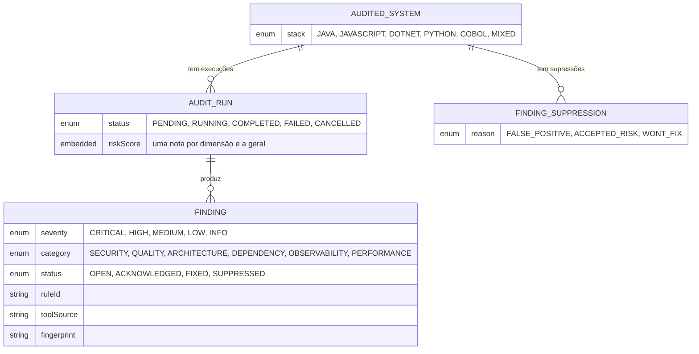

- `model`: `AuditedSystem`, `AuditRun`, `Finding`, `FindingSuppression` (entidades), `RiskScore` (objeto embutido em `AuditRun`), `Severity`, `Category`, `Stack`, `FindingStatus`, `AuditStatus`, `SuppressionReason` (enums).
- `repository` (Panache): `AuditedSystemRepository`, `AuditRunRepository`, `FindingRepository`, `FindingSuppressionRepository`.
- `dto`: `CreateSystemRequest`, `CreateAuditRequest`, `ProfileRequest`, `ScheduleRequest`, `SuppressRequest` (entradas); `SystemSummaryResponse`, `AuditRunResponse`, `FindingResponse`, `RiskScoreDto`, `RemediationDto`, `AuditDiffResponse`, `TrendPoint`, `SuppressionResponse` (saídas); `FindingMapper` converte entidade em resposta (inclui a orientação de correção).

---

## 4. CLI `audit-cli`

Um único pacote, `com.sentinel.audit.cli`, usado por pipelines de CI.

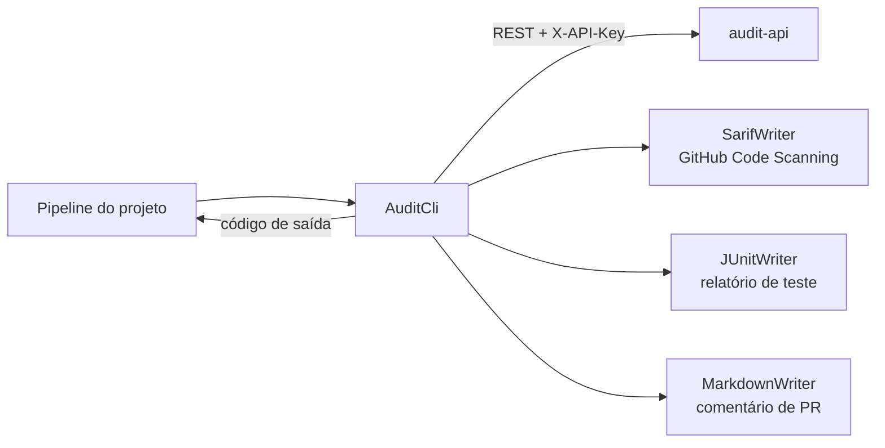

| Classe | O que faz |
|---|---|
| `AuditCli` | Dispara a auditoria, acompanha a cada 10 s e aplica os portões: `--fail-below <score>`, `--fail-on <severidade>`, `--fail-on-new <severidade>`. Saída 0 = aprovado, 1 = reprovado pelo portão, 2 = erro, 3 = tempo esgotado |
| `SarifWriter` | Converte os achados para SARIF 2.1.0 (GitHub Code Scanning, Azure DevOps, GitLab, VS Code) |
| `JUnitWriter` | Cada achado vira um teste que falhou (JUnit XML) |
| `MarkdownWriter` | Resumo em Markdown para comentar em PR (o CLI só grava; quem posta é o pipeline) |

---

## 5. Frontend `audit-dashboard`

React 18, TypeScript, IBM Carbon Design System, Vite, TanStack Query (dados do servidor), Zustand (filtros e seleção), React Router.

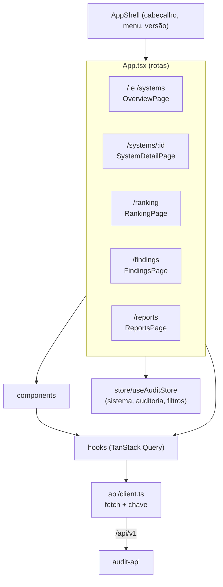

| Camada | Arquivos | Papel |
|---|---|---|
| Páginas | `OverviewPage`, `SystemDetailPage`, `RankingPage`, `FindingsPage`, `ReportsPage` | Lista de sistemas e cadastro; detalhe com nota, tendência e visão completa; ranking de sistemas e qualidade das regras; achados com filtros; relatórios |
| Componentes | `FindingsTable`, `ScoreGauge`, `RiskBadge`, `TrendChart`, `DiffSummary`, `InsightsPanel`, `RemediationBlock`, `SuppressModal`, `SuppressionsList`, `ProfileForm`, `ScheduleForm`, `Layout/AppShell` | Tabela de achados, medidor de nota, selo de severidade, gráfico de tendência, novo × corrigido, auditoria completa, como corrigir, supressão com justificativa, perfil de regras, agenda |
| Hooks | `useSystems` (`useSystem`, `useRuleQuality`), `useAuditRuns` (`useAudit`), `useFindings`, `useLifecycle` (tendência, diferença, supressões, visão completa, pacotes, perfil, agenda) | Cada um encapsula uma consulta ou mutação ao servidor |
| Estado | `store/useAuditStore` | Sistema e auditoria selecionados e filtros de achados |
| Acesso à API | `api/client.ts` | `apiFetch` e o objeto `api` com cada endpoint |
| Apoio | `types/index.ts`, `utils/ranking.ts`, `vite-env.d.ts` | Tipos do contrato, cálculo do ranking |
| Testes | `RiskBadge.test`, `ScoreGauge.test`, `AppShell.test`, `test/a11y.test` (axe) | 16 testes (Vitest + Testing Library) |

Em produção a SPA é servida pelo Nginx (`nginx.conf.template`), que repassa `/api` para a API.

---

## 6. Regras e ferramentas `audit-rules`

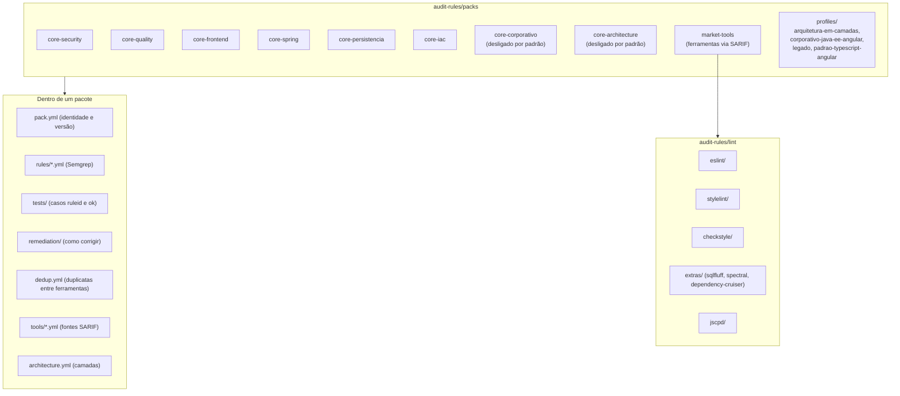

- Cada pacote tem `pack.yml`, regras em `rules/`, casos de teste em `tests/` (`// ruleid:` deve casar, `// ok:` não) e uma entrada de remediação por regra.
- `market-tools` declara as ferramentas externas (`tools/*.yml`: `api`, `arquitetura`, `css`, `duplicacao`, `infra`, `java`, `javascript`, `sql`), cada uma só roda se estiver instalada e se o projeto tiver arquivos do tipo que ela entende.
- Perfis (`profiles/*.yml`) escolhem pacotes, desligam ou mudam a severidade de regras e põem regras em modo sombra (aparecem, mas não reprovam).
- Verificação: `semgrep --test` por pacote e `audit-rules/scripts/testar-regex-sql.py` para regras de SQL/XML (que o `semgrep --test` não avalia). Calibração em repositórios reais: `audit-rules/calibracao`.
- Ferramenta de autor: `audit-rules/bin/sentinel-pack` (executa `PackTool`).

---

## 7. Implantação e segurança

| Item | Detalhe |
|---|---|
| `docker-compose.yml` | `postgres` (16-alpine, só no localhost), `audit-api`, `audit-dashboard` |
| `audit-api/Dockerfile` | Constrói com Maven (Java 21) e roda em JRE 21 com Git, Semgrep, Trivy, Gitleaks, Node (ESLint, Stylelint) e ferramentas Python em ambientes virtuais; telemetria do Semgrep desligada |
| `deploy/helm/sentinel` | Chart com `api`, `dashboard`, `ingress`, `postgres` e `secret` |
| Autenticação | Chave estática `X-API-Key` (`ApiKeyFilter`) ou OIDC/Keycloak em build com `-Poidc` (`QUARKUS_PROFILE=oidc`, com `API_KEY` vazia) |
| Clone | `GIT_ALLOWED_HOSTS` limita os hosts; `GIT_TOKEN` com `GIT_TOKEN_HOSTS` só vai para os hosts listados; clone raso (`GIT_HISTORY_DEPTH`) |
| Pacotes | YAML lido sem instanciar classes (`Yamls`), integridade por SHA-256 e assinatura Ed25519 (`PackIntegrity`); `eslint.config.js` do projeto auditado nunca é carregado (seria código executado no servidor) |
| Segredos | O valor de um segredo achado nunca é gravado, só um hash curto |
| Avisos | `StartupChecks` emite alerta de configuração insegura |

---

## 8. Automação: CI, release e agentes

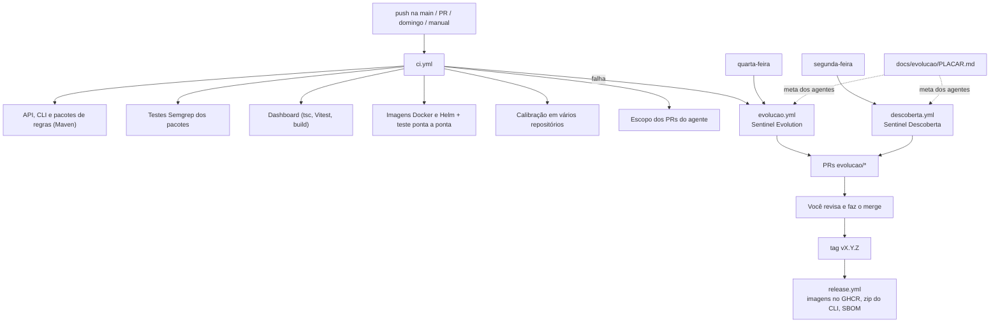

| Parte | Arquivos |
|---|---|
| CI | `.github/workflows/ci.yml`, `scripts/ci-anotar.sh` (transforma falhas em anotações legíveis), `scripts/e2e.sh` (Postgres + API + auditoria do petclinic) |
| Calibração | `scripts/calibracao.sh`, `scripts/comparar-calibracao.py`, `audit-rules/calibracao/esperado.json` |
| Release | `.github/workflows/release.yml`, `scripts/versoes-pacotes.sh` |
| Sentinel Evolution | `.github/workflows/evolucao.yml`, `.github/agente/sentinel-evolution.md`, `scripts/evolucao-entrada.sh` |
| Sentinel Descoberta | `.github/workflows/descoberta.yml`, `.github/agente/sentinel-descoberta.md`, `scripts/descobrir-repos.sh`, `scripts/relatorio-descoberta.py` |
| Memória e metas | `docs/evolucao/` (`PLACAR.md`, `LOG.md`, `calibracao.md`, `precisao.md`, `relatorios/`, `AGENTE.md`) |

Os agentes só abrem PR em `evolucao/*`; o merge é manual. O job `Escopo dos PRs do agente` reprova PR que mexa em `.github/`, scripts de entrada/CI, `.gitignore` ou `.env*`.

---

## 9. Terceiros

| Terceiro | Onde entra | Obrigatório? |
|---|---|---|
| Quarkus 3.15, Hibernate/Panache, JAX-RS | Backend | sim |
| PostgreSQL 16 | Persistência | sim |
| React 18, IBM Carbon, TanStack Query, Zustand, React Router, Vite, Vitest | Dashboard | sim |
| Semgrep | `SemgrepAnalyzer` (regras dos pacotes) | recomendado; sem ele a análise de regras fica de fora |
| Trivy | `TrivyAnalyzer` (SCA e IaC) | opcional; substitui o SCA interno |
| Gitleaks | `GitleaksAnalyzer` (segredos e histórico) | opcional; substitui os analisadores internos de segredo |
| PMD | `PmdAnalyzer` | opcional |
| ESLint (+ Angular ESLint, html-eslint), Stylelint | `EslintAnalyzer`, `SarifAnalyzer` | opcional (stack web) |
| SQLFluff, Squawk, Hadolint, Checkov, Spectral, Checkstyle, jscpd, Dependency-Cruiser, njsscan, kube-linter, kube-score | `SarifAnalyzer` via `market-tools` | opcionais; cada uma só roda se instalada |
| OSV.dev | `OsvClient` (consulta de vulnerabilidades por dependência) | opcional (`OSV_ENABLED`) |
| GitHub / GitLab | Clone e webhooks | sim, para repositórios remotos |
| Teams / Slack / webhook genérico | `NotificationService` | opcional |
| Keycloak / OIDC | Autenticação corporativa | opcional |
| GitHub Actions, GHCR, `anthropics/claude-code-action` | CI, release e agentes | só para o desenvolvimento do próprio Sentinel |

---

## 10. Limites deste documento

- Os papéis das classes vêm do nome, do comentário e da leitura dos pontos principais (`AuditOrchestrationService`, `ScoringService`, camadas, dashboard). Classes grandes como `PackLoader` (641 linhas), `ArchitecturePolicyAnalyzer` (534) e `InsightsBuilder` (344) estão descritas pelo comentário de classe, não por leitura linha a linha.
- A lista de analisadores executados por padrão é a de `AuditOrchestrationService.runAnalyzers` (14 candidatos); o que de fato roda depende das ferramentas instaladas, da stack do sistema e do perfil.
- Os pesos e o teto do score vêm de `ScoringService` hoje; mudam com o código. Em caso de dúvida vale o código.
- Este documento não foi gerado automaticamente: se uma classe nascer, mudar de pacote ou sair, ele precisa de atualização manual (o agente de evolução pode propor isso num PR).
